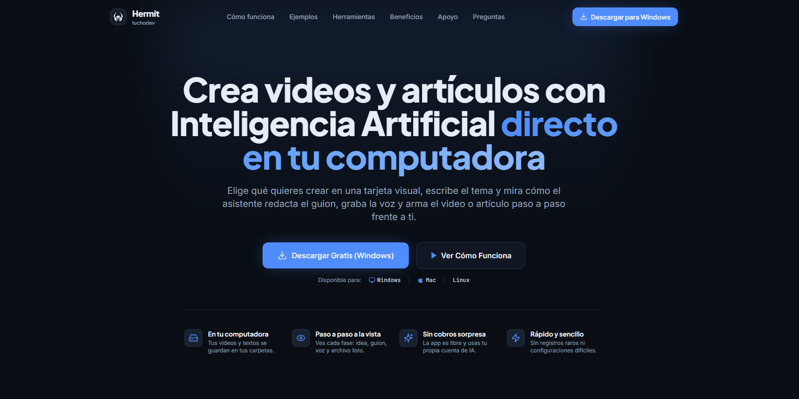

<p align="center">
  
</p>

<p align="center">
  
  
  <a href="LICENSE"></a>
</p>

<p align="center">
  <a href="https://github.com/condoriluis/Hermit/releases"><b>Descargar</b></a> ·
  <a href="https://myhermit.vercel.app">Página oficial</a> ·
  <a href="https://myhermit.vercel.app/#apoyo">Apoyar</a>
</p>

---

**Hermit** es una app de escritorio que crea contenido y videos verticales para TikTok, Reels y YouTube Shorts de forma local. Eliges una herramienta o estilo, le das un tema o un enlace, y agentes de inteligencia artificial investigan, redactan el guion, gestionan la voz y generan el contenido en tu computadora. Todo transparente: ves el progreso en tiempo real y pides cambios en lenguaje natural.

Creado y mantenido por **luchodev**. Es libre, sin costo oculto y con soporte opcional.

## Cómo funciona

Cada formato es una **herramienta** visible en la pantalla principal:

| Fase | Qué pasa |
| --- | --- |
| **Idea** | Investiga el tema: lee el enlace, recopila fuentes y reúne material. |
| **Guion** | Redacta el guion con gancho inicial y remate de impacto. |
| **Voz** | Puedes subir tu grabación de audio o generar voz con IA. |
| **Video** | Ensambla las escenas y renderiza el contenido localmente. |
| **Entrega** | Video final listo con portada para previsualizar o descargar. |

## Correr desde el código

```bash
git clone https://github.com/condoriluis/Hermit.git
cd Hermit
npm ci
npm start
```

`npm start` inicia el servidor local en `http://localhost:4848` y abre la ventana de Hermit.

## Arquitectura

| Pieza | Con qué |
| --- | --- |
| Ventana de escritorio | [Electron](https://www.electronjs.org) empaquetado para Windows, Mac y Linux |
| Interfaz de usuario | React 19, Vite, Tailwind CSS (`web/`) |
| Servidor local | Node.js (`server/`): sesiones, websockets, tareas en segundo plano |
| Landing y API | Next.js 16+, Supabase, PayPal y QR Simple (`landing/`) |
| Los agentes | [Claude Agent SDK](https://docs.anthropic.com/en/docs/claude-code/sdk), con tu cuenta de Claude |
| Los videos | [Remotion](https://www.remotion.dev) en cada estilo, y Python para transcribir y descargar |
| El cobro y la comunidad | Un Worker de Cloudflare con D1 y R2 (`licencias/`) |

```
electron/   la ventana de escritorio
server/     el servidor local que corre los agentes
web/        la interfaz
shared/     los tipos que comparten servidor e interfaz
skills/     los estilos de video (El Diff, explicativo, reel de comedia, documental) y sus herramientas
licencias/  el cobro del apoyo, la comunidad y las descargas (Cloudflare Worker)
nube/       la nube que publica en Instagram (Cloudflare Worker)
python/     los procesos de Python de Hermit
scripts/    compilar, publicar y desplegar
docs/       las decisiones (adr/) y las guías para agentes (agents/)
```

Las reglas del proyecto y el mapa del código están en [`AGENTS.md`](AGENTS.md) y
[`docs/agents/mapa.md`](docs/agents/mapa.md).

## Roadmap

Las metas se cuentan con las personas que apoyan hoy. Cada versión nueva la reciben todos a la vez.

| Personas que apoyan | Qué sale |
| --- | --- |
| 25 | Hermit firmada por Apple: en Mac se abre sin avisos y se actualiza sola |
| 50 | Publicar en YouTube desde Hermit, con su API oficial |
| 100 | Publicar en Instagram y Facebook, con la API oficial de Meta |
| 150 | Publicar en TikTok, con su API oficial |
| 250 | La tienda de estilos: sube los tuyos y usa los de la comunidad |

El orden lo puede cambiar la comunidad: se vota dentro de Hermit, y el voto de un Fundador vale doble.
[Míralo en vivo en la página](https://myhermit.vercel.app/#roadmap).

## Apoya a Hermit

Hermit es gratis y lo seguirá siendo. Si te sirve, puedes [apoyarla](https://myhermit.vercel.app/#apoyo) desde
5 USD al mes (o 50 USD al año): con ese apoyo salen las metas del roadmap. Las primeras 25 personas que apoyan son
**Fundadores** para siempre, con insignia en la comunidad, su nombre en los créditos de la página y voto doble.

## Aportar

Los PRs son bienvenidos. Lee [`CONTRIBUTING.md`](CONTRIBUTING.md) antes de empezar: la interfaz va en español, la
paleta es la de Hermit y cada cambio se comprueba en Windows, Mac y Linux. Para reportar un problema de seguridad, no
abras un issue: sigue [`SECURITY.md`](SECURITY.md).

## Créditos

El estilo **Documental** parte de EDITOR V1, de [NextPhase AI](https://www.skool.com/nextphase-5790/about), que
venía para HyperFrames; en Hermit se dibuja con Remotion.

## Licencia

**Código abierto para uso libre, sin reventa.** Puedes usar Hermit para lo que quieras (también para trabajos de
paga), modificarla y compartirla. Lo que no puedes es venderla, ni una versión modificada, ni un servicio cuyo valor
venga de ella. Los videos que hagas son tuyos y los puedes vender. Es la [Apache 2.0 con Commons Clause](LICENSE), a
nombre de [luchodev](https://myhermit.vercel.app); por esa condición no es «open source» según la definición de la OSI.

Remotion, que arma los videos, tiene su [propia licencia](https://www.remotion.dev/license): gratis para personas y
equipos pequeños; las empresas más grandes pagan la suya. Hermit no está afiliada, patrocinada ni respaldada por
Anthropic ni por OpenAI.

<p align="center"><sub>Hecho por <a href="https://myhermit.vercel.app">luchodev</a> en México</sub></p>
